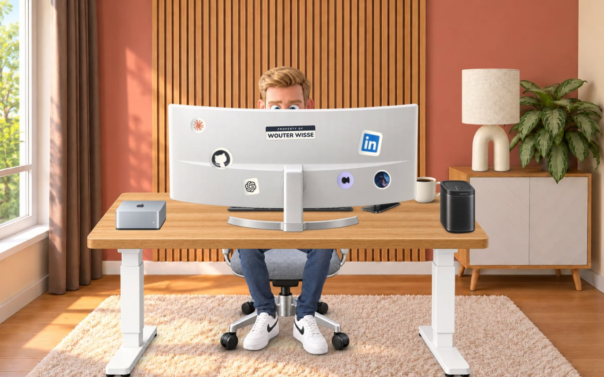

<div align="center">
  <picture>
    <source media="(prefers-color-scheme: dark)" srcset=".github/assets/hero-dark.jpg">
    
  </picture>
  <br>
  <br>
  <picture>
    
  </picture>
  <br>
  <br>
  <em>My personal website, with a layered illustration of my home office.</em>
  <br>
  <br>
  <a href="https://wouterwisse.com">wouterwisse.com</a>
  <br>
  <br>
  <a href="https://nextjs.org/"></a>
  <a href="https://react.dev/"></a>
  <a href="https://tailwindcss.com/"></a>
  <a href="https://www.typescriptlang.org/"></a>
  <a href="https://vercel.com/"></a>
</div>

## Tech Stack

| Component | Technology |
|-----------|------------|
| Framework | Next.js 16 (App Router) |
| UI | React 19, Tailwind CSS 4 |
| Language | TypeScript |
| Animation | CSS and the Web Animations API |
| Analytics | Vercel Analytics & Speed Insights |
| Fonts | Geist Sans & Geist Mono |
| Image Processing | Sharp |
| Deployment | Vercel |

## Office scene

The homepage uses one fixed composition with ten independently replaceable layers:
room, chair, complete seated character, desk, keyboard, monitor, Mac Studio, phone,
coffee mug, and lamp.
All foreground assets have real alpha transparency and baked contact shadows. The
neutral pose sits behind the monitor. The deeper desktop has room for the keyboard
behind the monitor base, with the character's fingertips resting on the keys.
The original soft radial fade and blur surround the assembled scene.

- Source PNGs: `public/images/office/scene/sources/`
- Optimized WebP assets: `public/images/office/scene/`
- Placement and stacking: `src/config/office.ts` (1536 × 1024 scene coordinates)
- Generation prompts: `docs/office-layers.json`, `docs/office-night-prompts.json`, `docs/office-expression-prompts.json`
- Night assets: `public/images/office/scene/night/`
- Shoe contact-shadow renders: `docs/office-shoe-shadow-prompts.json`; day and night character assets preserve the existing legs and upper body.
- Facial frames: `public/images/office/scene/expressions/`
- Rebuild optimized assets and validate transparency: `npx tsx scripts/prepare-office-assets.ts`
- Rebuild night assets: `npx tsx scripts/prepare-office-assets.ts --night`
- Validate composition, connected character, and baked contact shadows: `npm run test:office`

Click the lamp to switch between daylight (lamp off) and night (warm lamp on).
The saved mode takes precedence over the system preference. All ten layers have
separate night artwork with baked warm lighting and shadows; switching modes
crossfades those assets without a global tint or lamp filter. Only the fabric shade
is emissive; the ceramic lamp base receives reflected light.
Typing runs in short, irregular bursts with subtle movement of the complete body
and fingertips. The right foot (screen left) taps in occasional bursts of 2–4 taps,
with varied speed and pauses; it stops in hidden tabs and with reduced motion.
The 18 key-tap sounds from `ctrlaltwisse` in `public/sounds/` start
once the visitor turns sound on with the speaker button (or starts the music on the Sonos).
On iOS that switches the page's audio session to playback, so sound also plays with the
ring/silent switch on. Typing pauses
in hidden tabs, and reduced-motion preferences disable movement, expressions and
lamp shake. Blinks use half-closed and closed frames at irregular intervals, with
occasional amused expressions. Only the head is replaced; the connected body and
hands stay fixed behind the desk. Each expression has matching day/night lighting.

Tap the phone for an illuminated screen, vibration, the supplied iPhone notification
sound and an annoyed growl. Tap the cup to pause typing, lift it for a recorded
sip, and return it empty. Tapping the lamp refills both coffee (day) and tea (night).
Reactions cannot overlap; switching the lamp or hiding the tab cancels the current
sequence. The speaker button mutes typing and effects together. Reduced motion
keeps the static reaction poses without shaking or moving the cup.
The character stays seated; the monitor occludes his lower face, the lifted cup,
and his torso.

Tap the Mac Studio for turbo mode: its front status light pulses, the Mac subtly
shakes, and the supplied vacuum recording plays quietly beneath the typing.
Only the typing sounds accelerate for 5.2 seconds. His hands and body
keep their normal pace; his head peeks slightly higher, then slowly settles behind
the monitor while he squints. A soft success ding and smile finish the sequence.
Tapping again while it runs triggers a brief
annoyed sideways glance without restarting the work. Lamp changes and hidden tabs
cancel the sequence; mute silences all audio, and reduced motion keeps the status
light steady, the Mac still, and the character still. No actual build or device operation runs.

Tapping the lamp plays the supplied switch recording in both directions, trimmed
to start immediately. The speaker button also mutes this effect.

The Sonos on the camera-right corner of the desk has a “Vibecode” hover label.
Tap it to toggle the supplied `deep-house.mp3`, streamed on demand and looped.
Wouter keeps typing with a smiling head bob and one rhythmic foot tap, still seated
behind the monitor. Phone, drink, turbo, and lamp interactions leave the track
running; their reactions take priority, then he returns to vibing. The global
mute silences music without resetting its playback position. Reduced motion
keeps the character still while music remains available.
The foot tap, head nod, and subtle Sonos squash/bounce share the track's measured
110 BPM beat (65 ms phase offset), driven by the audio playback clock so reactions,
pauses, and track loops cannot put the animation out of sync. The speaker keeps
bouncing while the character handles another interaction.

- Interaction artwork: `public/images/office/scene/interactions/` (source PNGs in `sources/`)
- Built-in ImageGen prompts: `docs/office-interaction-prompts.json`
- Turbo expression prompts: `docs/office-turbo-prompts.json`; artwork in `public/images/office/scene/expressions/`
- Sonos day/night artwork: `public/images/office/scene/{,night/}sonos.webp`; built-in ImageGen prompts in `docs/office-sonos-prompts.json`
- Current Sonos/Mac renders: `docs/office-desk-perspective-prompts.json`, using separate construction guides in `docs/office-perspective-guides/`. Depth recedes up-right for the Mac on the left and up-left for the Sonos on the right, following the desk's shared perspective. The Mac's LED sits on its front face, clear of the visible right side.
- Sound sources and licenses: `public/sounds/office-sources.md`

The monitor stickers peel from wherever they're grabbed: the fold sits halfway between the
grabbed spot and the pointer, and hovering lifts the edge nearest the mouse. Link stickers
(GitHub, LinkedIn, Besona and the music credit) stick back down on release. The Claude,
ChatGPT and "Property of" decals can be pulled clean off; released, they fall and fade
until the next visit. Peeling and pulling off have their own sticker sounds.

The 6wines sticker links to 6wines.nl but can also be pulled off: the mug pops away and a
bottle of 6wines red springs up in its place with a pop, wobbles and settles while he
glances at it with raised eyebrows. One sip (with a burp instead of the "ahh") leaves an
empty, opened bottle. Toggling the lamp puts the coffee or tea back.

- Sticker artwork and behaviour: `src/components/OfficeScene.tsx`
- Wine bottle prompts: `docs/office-wine-prompts.json`
- White skirting refinement: `docs/office-skirting-refinement.json`
- Link previews: `src/app/opengraph-image.jpg`

## Development

```bash
# Install dependencies
npm install

# Start development server (cleans .next first)
npm run dev

# Build for production
npm run build

# Start production server
npm run start

# Lint code
npm run lint

# Clean build artifacts
npm run clean
```

## Deployment

This site is deployed on [Vercel](https://vercel.com) with automatic deployments on push to the `develop` branch.

To deploy your own:
1. Fork this repository
2. Import to Vercel
3. Add your custom domain in Vercel dashboard

## Scene implementation

`Hero.tsx` provides the page layout. `OfficeScene.tsx` stacks the artwork in DOM order,
so the character is one complete body behind the desk. `office.ts` registers the assets
to the same coordinate system without changing their source images. Each layer can
be replaced, repositioned, or hidden independently.

The fingertips are revealed above the keyboard using skin-outline clips of the same
character asset, with a small offset toward the rear keys. The complete body remains
one image behind the desk.
